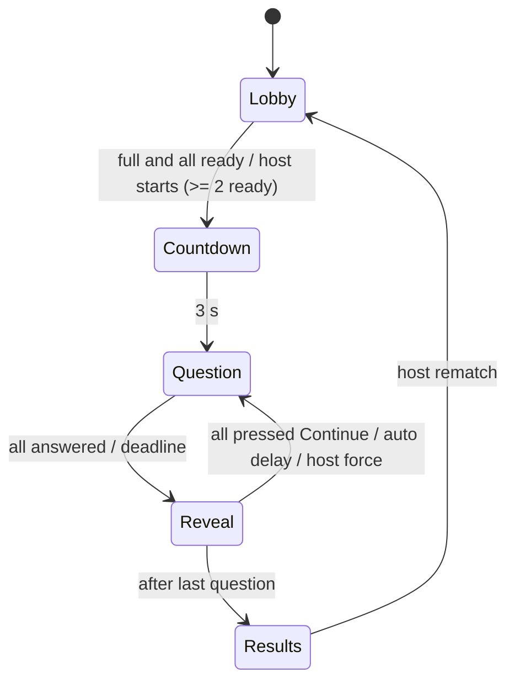

# Bytefight — Product & Build Plan

Name: **Bytefight**. Status: planning approved, build not started. Last updated: 2026-10-29.

Bytefight is a public, real-time multiplayer quiz battle for programming topics (C#, SQL, EF Core, ASP.NET, HTML, CSS, JS, …). Players register with a username and password, create or join a room with a short code, answer the same timed questions at the same moment, and earn a 5–12 rating and XP after every match. The first audience is IT Academy STEP students; registration is open to anyone.

---

## 1. Principles

1. **One click to play.** From the home page a logged-in user starts a room in at most two taps (Quick play = one tap).
2. **Same screen, same moment.** Every player sees the same question, the same timer and the same reveal.
3. **The server is the only authority.** Time, answers, points and ratings are decided on the server. The client renders snapshots and never receives a correct answer before the reveal.
4. **Calm game feel.** Points, animations, sounds and music exist, but stay light and soft so they never distract from thinking.
5. **Simple, explicit code.** Vertical slices, no unnecessary abstractions.

---

## 2. Accounts & auth

- **Register:** `username` + `password` only. Nothing else on the form.
  - Username: 3–20 chars, `[A-Za-z0-9_]`, unique case-insensitively (`citext`). Reserved names refused: `admin`, `support`, `system`, `bytefight`, `moderator`.
  - Password: minimum 8 chars. No other composition rules.
- **Login:** username + password → HttpOnly, Secure, SameSite=Lax auth cookie (ASP.NET Core cookie authentication). API and Angular are served from the same origin, so SignalR uses the same cookie. No JWT.
- **Hashing:** `PasswordHasher<User>` from `Microsoft.AspNetCore.Identity` (the hasher only, not the Identity framework).
- **Protection:**
  - Rate limiting (built-in `RateLimiter`): register 5/hour per IP, login 10/min per IP.
  - Lockout: 5 failed logins → account locked for 15 minutes.
- **No email and no password reset** in v1. Login is username + password only. If a user forgets the password, an admin can set a new one (§6, Users).
- **Roles:** `Player` (default), `Admin`. The first admin is seeded from configuration (`Admin:Username`).
- **Moderation (admin):** block a user, force-rename a username, set a new password.

---

## 3. Home & room flow

### Home page (logged in)
- Large **Quick play** button: creates a room with the user's last-used settings in one tap.
- **Category cards:** C#, SQL, EF Core, ASP.NET, HTML, CSS, JS, … plus **All**. Multi-select; **All** selects every active category.
- **Join with code** input (5 chars).
- Small links: Profile & stats, Leaderboard, Settings (sound, music, volume).

### Creating a room
1. Pick categories (multi-select or All) → pick difficulty (**Easy / Medium / Hard**) → **Create**.
2. Defaults for everything else: max players 4, 10 questions, manual advance.
3. The lobby shows the room code large, a copy button, and a join link `/join/{CODE}`.

### Joining
- Enter the code on Home, or open `/join/{CODE}`. Not logged in → login/register → back to the room.
- Room codes: 5 chars from `ABCDEFGHJKMNPQRSTUVWXYZ23456789` (no 0/O, 1/I/L). Rooms are private; there is no public room list in v1.

### Room settings (host only, editable in the lobby)

| Setting | Values | Default |
| --- | --- | --- |
| Categories | one or more, or All | last used |
| Difficulty | Easy / Medium / Hard | last used |
| Max players | 2–10 | 4 |
| Question count | 10–20 | 10 |
| After reveal | Manual (everyone presses Continue) / Auto | Manual |
| Auto-advance delay | 3–30 s (only when Auto) | 8 s |

Only the host (room creator) can change settings, start early, force-advance, kick a player, and start a rematch.

### Starting
- Each player presses **Ready**.
- The match starts automatically when the room is full and everyone is ready.
- The host can start early when at least 2 players are ready.
- 3-second countdown, then question 1.

### Practice (solo)
- One player, same rules, no XP and no rating. Useful for warm-up. Recorded in history marked as practice.

---

## 4. Game rules & scoring

### Question selection
- Each question has a `level` from 1 to 5. Difficulty selects a level band:
  - Easy → levels 1–2
  - Medium → levels 2–4
  - Hard → levels 3–5
- The server picks `questionCount` published questions at random from the selected categories within the band, **avoiding questions any player in the room saw in their last 5 matches** when the pool allows it.
- Order: sorted by level ascending (the match gets harder), **random order within the same level**.
- Answer options are **shuffled per match** (same order for every player in that match), so answers cannot be memorised by letter.

### Answering
- Every question has a time limit `L` (per question, see §5 defaults).
- Each player gets **one attempt** per question. After answering, a player is locked for that question.
- **Points depend only on answer time** `t` (seconds since the question started):

```
points = 500 + round(500 × (1 − t / L))      // 500..1000 for a correct answer
```

- **10-second window:** as soon as the first correct answer arrives, the deadline for everyone else becomes `min(L, firstCorrectAt + 10 s)`. Anyone who has not answered by the deadline gets **0**.
- **Wrong answer:** 0 points. In **Hard** mode a wrong answer costs **−200**.
- A player's running match total never goes below 0.
- The question ends when every connected player has answered, or at the deadline.

### Reveal
- No timer by default. Every player sees the correct answer, the explanation, each player's pick and points.
- Each player presses **Continue**. The screen shows who the room is still waiting for.
- The next question starts when every connected player has pressed Continue.
- If the host chose **Auto**, the next question starts after the configured delay (players can still press Continue to signal they are done).
- The host can always **force-advance** so an AFK player cannot stall the room. Disconnected players never block.

### Match rating (5–12)
At the end of a match every player gets a rating from 5 to 12 based on their score relative to the winner:

```
rating = 5 + round(7 × score / winnerScore)
```

- The winner always gets 12; a tie at the top gives 12 to each tied player.
- Minimum rating is 5 (motivation).
- If the top score is 0, everyone gets 5 and there is no winner.
- Example: scores 6400 / 5100 / 2300 / 0 → ratings 12 / 11 / 8 / 5.

### XP (profile & leaderboard)
More players means a bigger win:

```
XP = round(rating × (1 + 0.15 × (players − 2)))
```

- `players` = number of players at match start.
- Example: 2 players, rating 12 → 12 XP; 6 players, rating 12 → 19 XP; 6 players, rating 8 → 13 XP.
- Practice (solo) gives no XP.

### Leaving
- A player who disconnects keeps their seat for 60 s (reconnect resumes the match).
- After that, or after pressing Leave, the player is marked `left`. Remaining questions score 0. They still receive a rating and XP from their final score.
- If the host leaves, host rights pass to the longest-connected remaining player.

---

## 5. Question types

All types are multiple choice. There is no free-form code writing and no code execution.

| Type | Player sees | Player does | Default time `L` |
| --- | --- | --- | --- |
| `qa` | A concept question | Picks 1 of 4 text answers | 25 s |
| `bug` | A code snippet and a question about it | Picks what is wrong or what happens | 40 s |
| `missing` | A code snippet with one highlighted gap | Picks the code block (2–4 options) that makes it work | 45 s |

### Content rules
- Prompts, options and explanations: Georgian. Code: English.
- Every question has an explanation shown at the reveal.
- `missing` code marks the gap with a line containing only `/*___*/`; the client renders it as a highlighted empty slot. Options are code blocks (can be multi-line).

### Example (`missing`)

```json
{
  "type": "missing",
  "category": "efcore",
  "level": 3,
  "timeLimitSec": 45,
  "prompt": "რომელი ხაზი აკლია, რომ Blog-ს თავისი Posts ერთად წამოყვეს?",
  "code": "var blogs = await db.Blogs\n    /*___*/\n    .ToListAsync();",
  "options": [".Include(b => b.Posts)", ".Select(b => b.Posts)", ".Where(b => b.Posts != null)", ".AsNoTracking()"],
  "correctIndex": 0,
  "explanation": "Include ეუბნება EF Core-ს, რომ დაკავშირებული Posts იმავე query-ში ჩატვირთოს."
}
```

---

## 6. Content & admin panel

Questions and categories live in PostgreSQL and are managed from an admin panel (`/admin`, role `Admin`).

- **Categories:** create, rename, reorder, hide. Each has a `slug` (`csharp`, `sql`, `efcore`, `aspnet`, `html`, `css`, `js`).
- **Questions:**
  - CRUD with type, category, level, time limit, prompt, code, options, correct option and explanation.
  - **Live preview** that renders exactly like the game screen.
  - Status `draft` / `published`; only published questions enter matches.
- **Bulk import:** upload a JSON array in the format of §5. Validate everything, show errors per item, import all-or-nothing. The 30 prototype questions are the first import.
- **Question stats:** times shown, % correct, average answer time. Sortable, so the hardest and most-missed questions are easy to find.
- **Users:** search by username, block or unblock, force-rename, set a new password.

---

## 7. Profile, stats, history, leaderboard

- **Profile:** username, total XP, matches played, wins, average rating, best win streak.
- **By category:** accuracy % and average answer time per category.
- **History:** every finished match, newest first: date, categories, difficulty, players, rating, XP. A match detail page shows each question, every player's pick, time and points, and the explanation.
- **Leaderboard:** overall and per category, each for all time and this week (week starts Monday 00:00 Asia/Tbilisi).
    - Overall ranks by XP.
    - Per category ranks by category points: the sum of points a player earned on that category's questions (a match can mix categories, so match XP cannot be split cleanly). Practice matches do not count.

---

## 8. Architecture

| Layer | Choice |
| --- | --- |
| Repository | One monorepo: `api/` (.NET solution) and `web/` (Nx + pnpm workspace) |
| API | .NET 10 Minimal API + SignalR, Clean Architecture in 4 projects |
| Application style | Modules → features → use cases (vertical slices), MediatR **12.5.0** (pinned, last Apache-2.0 version) |
| Data | PostgreSQL 17, EF Core (Npgsql), code-first migrations |
| Live rooms | In memory: `ConcurrentDictionary<string, Room>`; one `SemaphoreSlim` per room serialises every mutation |
| Clock | `IClock` abstraction; one `PeriodicTimer` (200 ms) per active room drives deadlines and auto-advance |
| Persistence of matches | Written once, in one transaction, when a match finishes |
| Client | Nx workspace with two Angular 21 apps (`game`, `admin`), standalone components, Signals only, Tailwind CSS, `@microsoft/signalr` |
| Client tests | Playwright e2e only |
| Hosting | Free tiers to start, on the provider's free subdomain (no own domain). Everything stays in Docker so it can move to a paid host later without code changes |

### Repository layout

```
bytefight/
├── CLAUDE.md
├── docs/PLAN.md
├── docker-compose.yml
│
├── api/
│   ├── Bytefight.slnx
│   ├── Directory.Build.props
│   ├── Directory.Packages.props            # central package versions (MediatR pinned to 12.5.0)
│   ├── src/
│   │   ├── Bytefight.Domain/
│   │   │   ├── Identity/                   # User, Role
│   │   │   ├── Content/                    # Category, Question, QuestionType
│   │   │   ├── Game/                       # Room (state machine), Player, Scoring, Rating, Xp, QuestionPicker rules
│   │   │   └── Common/                     # Entity base, Result, Error
│   │   ├── Bytefight.Application/
│   │   │   ├── Abstractions/               # repositories, readers, IUnitOfWork, IClock, IGameNotifier, IPasswordHasher, IRoomStore
│   │   │   ├── Behaviors/                  # MediatR pipeline: validation, logging
│   │   │   └── Modules/
│   │   │       ├── Identity/Features/
│   │   │       │   ├── Auth/               # Register, Login, Logout, Me
│   │   │       │   └── Users/              # BlockUser, RenameUser, UpdateSettings (admin + self)
│   │   │       ├── Content/Features/
│   │   │       │   ├── Categories/         # CreateCategory, UpdateCategory, ReorderCategories, ListCategories
│   │   │       │   └── Questions/          # CreateQuestion, UpdateQuestion, ImportQuestions, ListQuestions, GetQuestionStats
│   │   │       ├── Game/Features/
│   │   │       │   ├── Rooms/              # CreateRoom, JoinRoom, UpdateRoomSettings, SetReady, Kick, Leave
│   │   │       │   └── Match/              # StartMatch, SubmitAnswer, Continue, ForceAdvance, Rematch, FinishMatch
│   │   │       └── Stats/Features/
│   │   │           ├── Profile/            # GetProfile, GetHistory, GetMatchDetail
│   │   │           └── Leaderboard/        # GetLeaderboard
│   │   ├── Bytefight.Infrastructure/
│   │   │   ├── Persistence/                # AppDbContext, configurations, migrations, Repositories/, Readers/
│   │   │   ├── Identity/                   # PasswordHasher adapter
│   │   │   ├── Game/                       # InMemoryRoomStore, RoomTicker (PeriodicTimer)
│   │   │   └── Time/                       # SystemClock
│   │   └── Bytefight.Api/
│   │       ├── Endpoints/                  # Minimal API mapping per module (Identity, Content, Stats)
│   │       ├── Realtime/                   # GameHub, SignalRGameNotifier, SnapshotProjector
│   │       ├── Auth/                       # cookie auth, Admin policy, rate limiting
│   │       └── Program.cs
│   └── tests/
│       ├── Bytefight.Tests.Common/         # builders, FakeClock, Testcontainers PostgreSQL fixture
│       ├── Bytefight.UnitTests/
│       │   ├── Domain/                     # scoring, rating, XP, Room state machine, picker rules
│       │   └── Application/                # only handlers that hold real logic
│       ├── Bytefight.IntegrationTests/     # WebApplicationFactory + PostgreSQL + SignalR test clients
│       └── Bytefight.ArchitectureTests/    # layer dependencies + module isolation
│
└── web/                                    # Nx + pnpm
    ├── nx.json
    ├── package.json
    ├── pnpm-workspace.yaml
    ├── apps/
    │   ├── game/                           # player app
    │   ├── game-e2e/                       # Playwright
    │   ├── admin/                          # admin panel
    │   └── admin-e2e/                      # Playwright
    └── libs/
        └── shared/
            ├── ui/                         # buttons, inputs, cards on top of the chosen Tailwind UI library
            ├── question-card/              # renders a question; used by the game AND the admin preview
            ├── api-client/                 # DTO types, HTTP clients, SignalR client feeding signals
            └── tokens/                     # tokens.css + Tailwind theme (values from §11)
```

### API rules
- **Dependencies point inward:** Api → Infrastructure → Application → Domain. Domain references nothing. Application references only Domain.
- **Modules are folders, not projects.** A module's features never call another module's features directly. Cross-module reads go through read interfaces; cross-module actions go through MediatR notifications (for example `MatchFinished` → Stats).
- **One use case = one folder** with its command or query, handler, validator (FluentValidation) and response type.
- **Game logic lives in Domain.** `Room` owns the state machine. `Scoring`, `Rating` and `Xp` are pure static functions. Handlers only load, call and save.
- **Repository pattern.** Application never references EF Core.
    - Writes: one repository per aggregate root (`IUserRepository`, `ICategoryRepository`, `IQuestionRepository`, `IMatchRepository`) + `IUnitOfWork.SaveChangesAsync`.
    - Reads that return DTOs (lists, profile, history, leaderboard, question stats): read interfaces per module (`IContentReader`, `IStatsReader`) that project with EF Core in Infrastructure.
    - Live rooms: `IRoomStore` (in memory).
    - No generic `IRepository<T>`, no AutoMapper.
- **MediatR is pinned to 12.5.0.** Versions 13+ are commercial; never upgrade.
- **All user-facing API messages** (validation and errors) are in Georgian, so the client shows them as they are.

### Web rules
- Two apps share four libraries. The question card is rendered only by `libs/shared/question-card`, so the admin preview and the game can never differ.
- Nx module boundaries (tags `scope:game`, `scope:admin`, `scope:shared`): apps may import `shared`; `game` and `admin` never import each other.
- All UI text is Georgian, written directly in templates. No i18n library.
- Tailwind theme colours, fonts and radii come from `libs/shared/tokens`.

### Tests
| Project | Covers |
| --- | --- |
| `Bytefight.UnitTests` | Domain: formulas, state machine, picker rules. Application: only handlers with real logic |
| `Bytefight.IntegrationTests` | Endpoints, auth rules, persistence, full matches over SignalR against real PostgreSQL (Testcontainers) |
| `Bytefight.ArchitectureTests` | Layer dependencies, module isolation, naming (handlers end with `Handler`) |
| `Bytefight.Tests.Common` | Shared builders, `FakeClock`, database fixture (no tests of its own) |
| `game-e2e`, `admin-e2e` | Playwright user flows; the game suite plays a 3-player match with 3 browser contexts |

## 9. Data model

PostgreSQL. EF Core migrations produce the real schema; this DDL is the reference.

```sql
CREATE EXTENSION IF NOT EXISTS citext;

CREATE TABLE users (
    id              uuid PRIMARY KEY,
    username        citext NOT NULL UNIQUE,
    password_hash   text NOT NULL,
    role            text NOT NULL DEFAULT 'Player' CHECK (role IN ('Player', 'Admin')),
    xp              integer NOT NULL DEFAULT 0 CHECK (xp >= 0),
    is_blocked      boolean NOT NULL DEFAULT false,
    failed_logins   smallint NOT NULL DEFAULT 0,
    lockout_until   timestamptz,
    settings        jsonb NOT NULL DEFAULT '{}',   -- sound, music, volume, last room settings
    created_at      timestamptz NOT NULL DEFAULT now()
);

CREATE TABLE categories (
    id          smallint GENERATED ALWAYS AS IDENTITY PRIMARY KEY,
    slug        text NOT NULL UNIQUE,
    name        text NOT NULL,
    sort_order  smallint NOT NULL DEFAULT 0,
    is_active   boolean NOT NULL DEFAULT true
);

CREATE TABLE questions (
    id              uuid PRIMARY KEY,
    category_id     smallint NOT NULL REFERENCES categories(id),
    type            text NOT NULL CHECK (type IN ('qa', 'bug', 'missing')),
    level           smallint NOT NULL CHECK (level BETWEEN 1 AND 5),
    time_limit_sec  smallint NOT NULL CHECK (time_limit_sec BETWEEN 10 AND 120),
    prompt          text NOT NULL,
    code            text,
    options         jsonb NOT NULL,               -- array of 2..4 strings
    correct_index   smallint NOT NULL CHECK (correct_index BETWEEN 0 AND 3),
    explanation     text NOT NULL,
    status          text NOT NULL DEFAULT 'draft' CHECK (status IN ('draft', 'published')),
    created_at      timestamptz NOT NULL DEFAULT now(),
    updated_at      timestamptz NOT NULL DEFAULT now()
);
CREATE INDEX ON questions (category_id, level) WHERE status = 'published';

CREATE TABLE matches (
    id              uuid PRIMARY KEY,
    room_code       text NOT NULL,
    host_user_id    uuid NOT NULL REFERENCES users(id),
    difficulty      text NOT NULL CHECK (difficulty IN ('easy', 'medium', 'hard')),
    category_slugs  text[] NOT NULL,
    question_count  smallint NOT NULL CHECK (question_count BETWEEN 10 AND 20),
    player_count    smallint NOT NULL CHECK (player_count BETWEEN 1 AND 10),
    is_practice     boolean NOT NULL DEFAULT false,
    started_at      timestamptz NOT NULL,
    finished_at     timestamptz NOT NULL
);

CREATE TABLE match_players (
    match_id    uuid NOT NULL REFERENCES matches(id) ON DELETE CASCADE,
    user_id     uuid NOT NULL REFERENCES users(id),
    score       integer NOT NULL CHECK (score >= 0),
    rank        smallint NOT NULL,
    rating      smallint CHECK (rating BETWEEN 5 AND 12),   -- null for practice
    xp          smallint NOT NULL DEFAULT 0,
    left_early  boolean NOT NULL DEFAULT false,
    PRIMARY KEY (match_id, user_id)
);
CREATE INDEX ON match_players (user_id);

CREATE TABLE match_questions (
    match_id      uuid NOT NULL REFERENCES matches(id) ON DELETE CASCADE,
    position      smallint NOT NULL,
    question_id   uuid NOT NULL REFERENCES questions(id),
    option_order  smallint[] NOT NULL,              -- shuffled order shown in this match
    PRIMARY KEY (match_id, position)
);

CREATE TABLE match_answers (
    match_id    uuid NOT NULL,
    position    smallint NOT NULL,
    user_id     uuid NOT NULL REFERENCES users(id),
    choice      smallint,                           -- original option index; null = no answer
    is_correct  boolean NOT NULL,
    answer_ms   integer,
    points      smallint NOT NULL,
    PRIMARY KEY (match_id, position, user_id),
    FOREIGN KEY (match_id, position) REFERENCES match_questions(match_id, position) ON DELETE CASCADE
);
```

Overall leaderboard: all-time = `users.xp`; weekly = `SUM(match_players.xp)` for matches finished this week.
Category leaderboard: `SUM(match_answers.points)` joined through `match_questions` → `questions.category_id`, non-practice matches only, all-time or this week. Add an index on `matches (finished_at)`.

---

## 10. Realtime protocol & state machine

One SignalR hub: `/hubs/game`, authenticated with the auth cookie.

### State machine (per room)



`Question` has a deadline of `L`, shortened to `firstCorrectAt + 10 s` when the first correct answer arrives.

### Client → server (hub methods)

| Method | Payload | Allowed in | Who |
| --- | --- | --- | --- |
| `CreateRoom` | `{ settings }` | — | any user |
| `JoinRoom` | `{ code }` | Lobby (or reconnect in any phase) | any user |
| `UpdateSettings` | `{ settings }` | Lobby | host |
| `SetReady` | `{ ready }` | Lobby | player |
| `StartMatch` | — | Lobby | host |
| `SubmitAnswer` | `{ position, choice }` | Question | player |
| `Continue` | `{ position }` | Reveal | player |
| `ForceAdvance` | — | Reveal | host |
| `Kick` | `{ userId }` | Lobby | host |
| `Leave` | — | any | player |
| `Rematch` | — | Results | host |

### Server → client
One event, **`Snapshot`**, with the whole public room state, pushed to the room's group on every change. Clients never patch state themselves.

```json
{
  "code": "K7QPM",
  "phase": "question",
  "serverNow": 1793213529000,
  "settings": { "categories": ["csharp", "efcore"], "difficulty": "medium", "maxPlayers": 4, "questionCount": 12, "autoAdvance": false, "autoAdvanceSec": 8 },
  "hostId": "…",
  "position": 3,
  "question": { "type": "missing", "prompt": "…", "code": "…", "options": ["…", "…", "…", "…"], "level": 2 },
  "startedAt": 1793213510000,
  "deadline": 1793213535000,
  "firstCorrectAt": 1793213525000,
  "players": [
    { "id": "…", "username": "ana", "score": 1740, "ready": true, "connected": true, "status": "answered", "continued": false },
    { "id": "…", "username": "luka", "score": 1210, "ready": true, "connected": true, "status": "thinking", "continued": false }
  ],
  "reveal": null,
  "results": null
}
```

- `status` per player during Question: `thinking` | `answered`. Whether a specific answer is right is never sent before the reveal; `firstCorrectAt` only tells everyone that someone was right and the 10-second window has started.
- `reveal` (correct option, explanation, each player's pick, correctness and points) is `null` until phase `reveal`.
- `results` (scores, ranks, ratings, XP) appears in phase `results`.
- `serverNow` lets the client compute a clock offset per snapshot, so timers on all screens agree within network latency.
- Answer time = when `SubmitAnswer` arrives at the server.

### Reconnect
- On reconnect the client calls `JoinRoom` with the same code; the server recognises the user and restores the seat (within 60 s).
- The client stores the current room code in `sessionStorage`.

---

## 11. Visual system

Calm study room: low-saturation sage and mist tones, one quiet accent, nothing flashing. The pressure comes from the clock and the other players, not from the screen.

### Principles
- One focal object per screen: the question card. Scores and the timer stay small and peripheral.
- The timer is one thin line that shrinks. It turns muted amber in the last 20 %; never red, never blinking.
- Wrong answers use a desaturated clay tone and plain wording.
- Each player has a stable colour for the match (avatar ring, picks at the reveal).
- Single column, max width 780 px, works from 360 px wide.

### Colour tokens

| Token | Role | Light | Dark |
| --- | --- | --- | --- |
| `--bg` | Page background | `#ECF0ED` | `#151C1A` |
| `--surface` | Panels, option rows | `#F6F8F6` | `#1B2421` |
| `--raised` | Question card | `#FFFFFF` | `#212C29` |
| `--line` | Borders, timer track | `#D2DBD6` | `#30403A` |
| `--ink` | Main text | `#22312D` | `#D8E2DE` |
| `--muted` | Secondary text | `#5F6F68` | `#93A59E` |
| `--accent` | Primary actions | `#46766D` | `#85B4AA` |
| `--accent-soft` | Accent tint | `#DCE7E2` | `#22352F` |
| `--ok` | Correct | `#3C7A55` | `#7BB991` |
| `--ok-soft` | Correct tint | `#DBEBE0` | `#1E3227` |
| `--bad` | Wrong (clay, not red) | `#A25D56` | `#D79890` |
| `--bad-soft` | Wrong tint | `#F1E1DE` | `#3A2522` |
| `--warn` | Last 20 % of time | `#9F7A3A` | `#D3B077` |
| `--code-bg` | Code blocks | `#EFF3F0` | `#121816` |

**Player colours** (avatar rings, picks), in seat order: `#46766D`, `#62749F`, `#9F7A3A`, `#875A88`, `#3C7A55`, `#A25D56`, `#5A8A9C`, `#7A6F4E`, `#6A7F5A`, `#8C6A7A`.

**Syntax colours:**
- Light: keywords `#3F7068`, strings `#93653A`, types `#5A6A9C`, numbers `#875A88`, comments `#86948E` italic.
- Dark: `#86B8AD`, `#D2A774`, `#A3B2DD`, `#C49BC6`, `#6E7F78`.

### Typography

| Role | Face | Use |
| --- | --- | --- |
| Display | Noto Serif Georgian 500/600 | Titles, question text, results |
| Body | Noto Sans Georgian 400/500/600 | UI text, options, explanations |
| Code | JetBrains Mono 400/500 | Code, room codes, scores, timers |

- Type scale: 13 / 16 / 20 / 28 / 44 px.
- Scores and timers use `font-variant-numeric: tabular-nums`.
- Radius: 14 px cards, 12 px options, pill buttons.
- Spacing: 8 px grid.
- One soft shadow, only on the question card.

---

## 12. Sound & motion

Light and soft. Everything can be turned off in Settings (sound, music, volume), stored in `users.settings`.

### Sound effects
Synthesised with the Web Audio API, so there are no audio files and no licensing.

| Event | Sound |
| --- | --- |
| Button press | very short soft click (sine, ~1.2 kHz, 30 ms, low volume) |
| Player joins lobby | soft two-note rise |
| Countdown tick | gentle tick each second, slightly higher on "go" |
| Answer submitted | soft tap |
| Correct (at reveal) | two-note major third, warm |
| Wrong (at reveal) | single low muted note, never harsh |
| Last 5 seconds | quiet tick once per second |
| Match won | short four-note arpeggio |

### Music
- One calm, low-tempo CC0 loop for lobby and play, at low volume.
- **Off by default**; the user turns it on once and the choice is remembered.

### Motion
- Score count-up after each reveal (~600 ms).
- Reveal panel rises in softly (~450 ms).
- Countdown number scales gently.
- Light confetti for the winner on the results screen (~1.5 s, few particles).
- `prefers-reduced-motion` disables all of it.

---

## 13. Delivery phases

Build one phase at a time. Each phase ends with something runnable and a "done when" check.

**Phase 0 — Skeleton**
- `api/`: solution with the 4 source projects and 4 test projects, `Directory.Packages.props` (MediatR 12.5.0 pinned), an architecture test that already enforces the layer rules.
- `web/`: Nx + pnpm workspace with `game`, `admin`, both `-e2e` projects (Playwright) and the four shared libraries; Tailwind wired to `libs/shared/tokens`.
- `docker-compose.yml` with PostgreSQL.
- Done when: `docker compose up` serves both empty apps, `/health` returns 200, `dotnet test` passes (architecture tests green) and `nx run-many -t e2e` runs a smoke test per app.

**Phase 1 — Accounts**
- Register, login, logout, `/me`, cookie auth, rate limiting, lockout, admin seed, settings JSON.
- Done when: register → logout → login works; the 6th wrong password is locked; integration tests cover these.

**Phase 2 — Content & admin**
- Categories and questions schema, `question-card` library, admin app (CRUD, preview through `question-card`, status, JSON import), import of the 30 prototype questions.
- Done when: an admin can create each of the 3 question types with a preview identical to the game card, and import rejects an invalid file with per-item errors.

**Phase 3 — Game server**
- Rooms, settings, ready/start, question picker, round engine, scoring, window, Hard penalty, reveal + Continue + auto + force, results, rating, XP, reconnect, persisting matches.
- Done when: unit tests cover scoring, rating and XP formulas and every state transition, and a 3-player integration test (SignalR test clients) plays a full 10-question match and finds it in the database.

**Phase 4 — Game client**
- Home (Quick play, categories, join), lobby, countdown, question, reveal, results; one `GameStore` (in `api-client`) with a `snapshot` signal and `computed` timers using the server offset.
- Done when: 3 browsers play a full match on desktop and phone, in light and dark theme.

**Phase 5 — Profile & leaderboard**
- Profile, per-category stats, history list, match detail, leaderboard (overall and per category, all-time and weekly).
- Done when: numbers on the profile match a hand-checked SQL query for a test user.

**Phase 6 — Sound & motion**
- Web Audio cues, music toggle, settings, animations, reduced motion.
- Done when: every sound in §12 plays and all can be muted; nothing moves with reduced motion on.

**Phase 7 — Deploy**
- Deploy to free tiers (container host for api + web, managed free PostgreSQL), on the provider's free subdomain. Basic logging; a manual `pg_dump` backup before each release.
- Done when: one STEP group plays a full session on the public URL without help.

---

## 14. Open questions

- [ ] Which free hosting providers (api + web, PostgreSQL)?
- [ ] More question types later (e.g. order the lines, predict the output).
